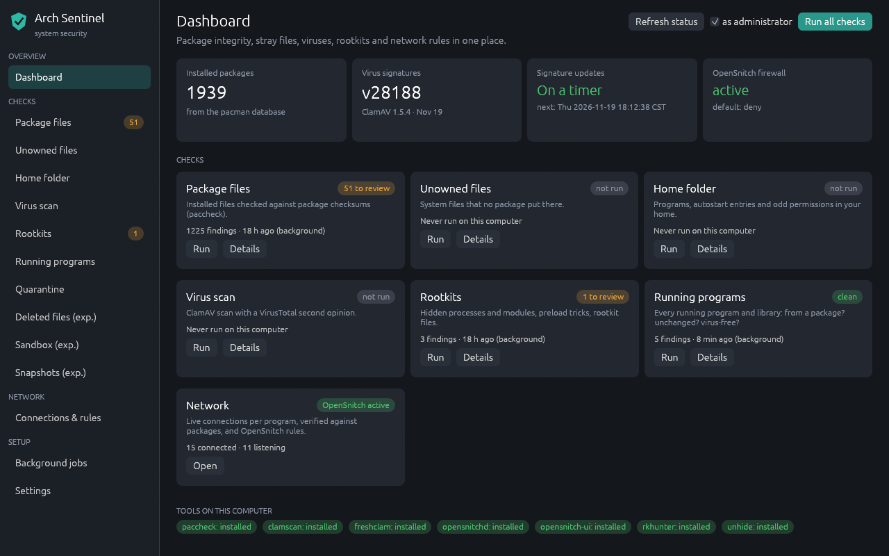
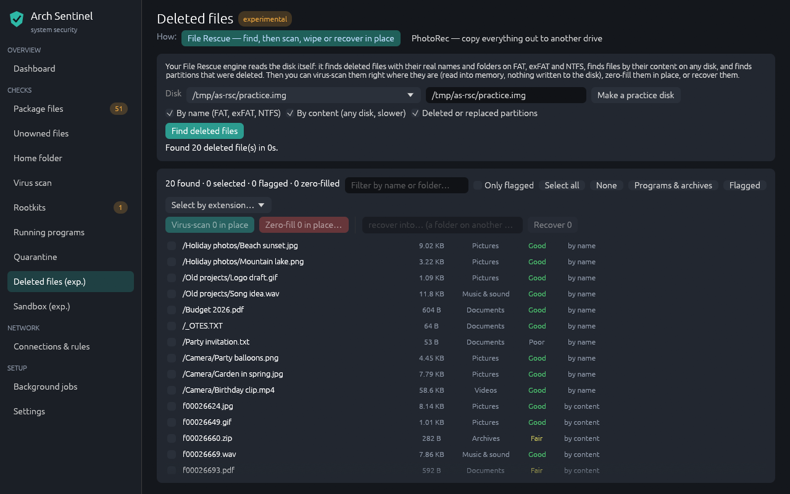
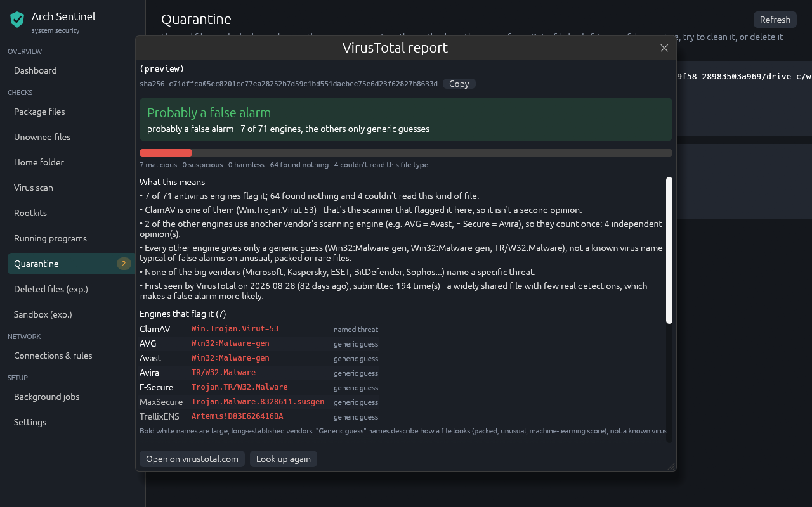

# Arch Sentinel

A desktop security console for Arch Linux. Check package integrity, find files no package owns, scan for viruses with ClamAV and get a second opinion from VirusTotal, look for rootkits, see which programs are on the network, and quarantine anything suspicious. It all runs from one native window, with an optional tray icon and scheduled background scans.

> [!WARNING]
> **This project was created with AI.** Most or all of the code, packaging and documentation was written by an AI model, with a person directing the work. It has not had an independent security audit. It runs with administrator rights for some checks, and a few experimental features can **delete or overwrite data**.
>
> **Use it only if you're comfortable with that.** Read the code before you trust it with your system, try it on a machine or disk you can afford to lose first, and don't rely on it as your only security tool.



## Features

### Checks
| Page | What it does |
|---|---|
| **Package files** | Compares every file an installed package put on the system with that package's recorded SHA-256, size and permissions (`paccheck`). Changed files in `/usr/bin` or `/usr/lib` get flagged as serious. Edits in `/etc` are usually your own. |
| **Unowned files** | Walks the system folders and lists anything the pacman database doesn't know about, especially programs and setuid files. You can ignore known caches with patterns in Settings. |
| **Home folder** | Looks in your home folder for what attackers usually leave behind: programs in hidden or cache folders, autostart entries, systemd user units, suspicious shell start-up lines and setuid files. |
| **Virus scan** | Multithreaded ClamAV scan. Anything it flags is fingerprinted and looked up on VirusTotal by SHA-256. **Only the hash is sent, never the file.** The VirusTotal report is explained in plain language, and engines that share code or give generic detections count for less. |
| **Rootkits** | Built-in checks in the spirit of rkhunter: processes or kernel modules hidden from their lists, `/etc/ld.so.preload`, files hiding in `/dev`, programs running from temp folders or deleted files, unexpected root-level accounts, and core system tools verified against their packages. Also runs `rkhunter` and `unhide` when they're installed. |
| **Running programs** | Matches every running program and its loaded libraries to the package that installed them, checks them against package checksums, and can ClamAV-scan them too. |
| **Paranoid check** | A heuristic structural look inside ELF and Windows PE files for signs of infectors, packers and backdoors. Each sign adds to a score, and only files that add up are reported. |
| **Quarantine** | Moves flagged files into a locked store with a record of where they came from. From there you can restore, delete, try to clean (including zip-style archives), or zero-fill and delete them. |

### Network
- **Connections & rules**: live connections per program, read from `/proc/net`, with each program checked against the package database.
- Reads and writes rules for the [OpenSnitch](https://github.com/evilsocket/opensnitch) application firewall.
- Flags ports that ordinary desktop software rarely uses but remote shells and malware often do.
- A tray watcher sends one desktop notification for each new program that wasn't installed by any package and goes online.

### Experimental
These are clearly labeled in the app. **Treat them with extra care.**
- **Deleted files / File Rescue**: reads a disk, partition or image read-only and finds deleted files by name (FAT12/16/32, exFAT, NTFS), by content (any disk), and in deleted or replaced partitions. You can then virus-scan them in memory, recover them with their original names, or zero-fill them in place. Zero-filling only touches a file when every part of it lies in space the current file system marks as free. Anything it can't confirm is skipped. Zero-filling also refuses to start while the disk is mounted, so nothing can write to the free space during the wipe. An **Unmount it** button (`udisksctl`) is offered. There's a **Make a practice disk** button so you can try it on a safe sample image first. A PhotoRec mode is also included.
- **Sandbox**: runs a suspicious program for a few seconds, or unpacks a suspicious archive, inside bubblewrap. There's no network, a fake empty home and a throwaway folder, and `strace` records what it tried to do. *This is a sandbox, not a virtual machine.* It won't stop malware that attacks the kernel.
- **Snapshots**: virus-scans btrfs snapshots (Timeshift, Snapper…). It mounts the btrfs top level **read-only** in a private folder and never changes anything inside a snapshot.



### Quality of life
- **One password prompt per session.** The first task that needs root starts a small helper through `pkexec`. Later tasks are passed to it over private pipes. It exits when you quit, end the session, or leave it idle.
- **Background jobs** use systemd timers. Each scan gets its own schedule, CPU limit, and power and notification options. `freshclam` runs on a system timer rather than as a daemon.
- **Low impact.** Scans run at the lowest CPU and disk priority (`nice 19`, idle I/O), with a configurable thread count.
- **Right-click "Scan for viruses (Arch Sentinel)"** in Dolphin and Nemo, and in Nautilus if you turn it on in Settings.
- Includes drives outside the running system, like USB sticks, extra disks and Windows partitions.
- Only one copy runs at a time. Opening it again, or right-click scanning, hands the request to the copy that's already running.

## Install (Arch Linux)

The package is built locally with `makepkg`. It isn't on the AUR.

```sh
git clone https://github.com/internetuser22/arch-sentinel.git
cd arch-sentinel/packaging/arch
makepkg -si
```

This builds the app, runs its tests, installs it as `arch-sentinel`, and pulls in everything it can use from the official repositories: `pacutils`, `clamav`, `opensnitch`, `rkhunter`, `unhide`, `testdisk`, `udisks2`, `bubblewrap`, `strace`, `polkit`, `curl`, `libnotify`, `zip`/`unzip` and more. No AUR helper is needed.

After installing, open **Background jobs** once and press **Apply scan timers**, then press **Install timer** for freshclam.

To update: pull, bump `version` in `Cargo.toml`, and run `makepkg -si` again.
To remove: `sudo pacman -R arch-sentinel`.

### Running from source
```sh
cargo run --release
```
Some pages expect the helper tools listed above to be installed.

## Command line

```
arch-sentinel                       open the window
arch-sentinel --tray                start hidden in the tray
arch-sentinel --scan PATH...        virus-scan these files or folders
arch-sentinel --background JOB      run one scan without a window and save its report
                                    (JOB: integrity, unowned, home, virus, rootkit, processes)
arch-sentinel --inspect FILE...     Paranoid check of program files (prints score and reasons)
arch-sentinel --screenshot FILE.png render the window to a PNG and exit
```

## VirusTotal




VirusTotal lookups are optional. Add your own free API key in **Settings**. Requests are paced for the free tier (4 a minute), and reports are cached on disk so reopening one doesn't use up your allowance. Only SHA-256 fingerprints are sent.

## Where things live

- Settings: `~/.config/arch-sentinel/settings.json`
- Scheduled scans: systemd user timers in `~/.config/systemd/user/`
- polkit action: `/usr/share/polkit-1/actions/org.archsentinel.policy`

## Built with

Rust · [egui/eframe](https://github.com/emilk/egui) · [goblin](https://github.com/m4b/goblin) (ELF/PE parsing) · [ksni](https://github.com/iovxw/ksni) (tray) · ClamAV · OpenSnitch · bubblewrap

## License

Released under the [MIT License](LICENSE).

## Disclaimer

Arch Sentinel is provided as-is, with no warranty. It is AI-generated, not a substitute for a professional security product or audit, and can produce both false positives and false negatives. Back up anything important before you use quarantine, zero-fill or the File Rescue tools.
